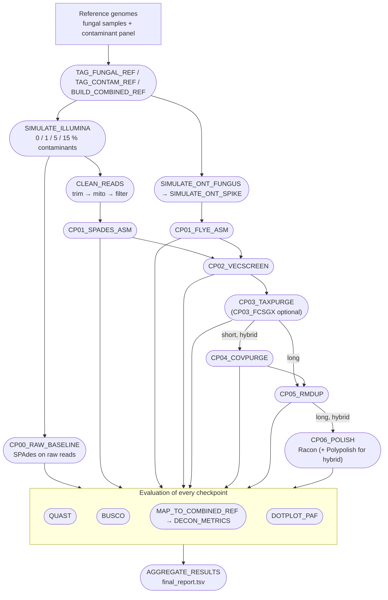

[](https://www.nextflow.io/)
[](https://pixi.sh/)

# AAFTF Benchmarking Workflow

A Nextflow workflow that measures what each step of [AAFTF](https://github.com/stajichlab/AAFTF) adds to a fungal
genome assembly. Reads are simulated from finished reference genomes with a known amount of contamination, so every
step can be scored against the truth. The full design is in [aaftf_benchmark_specification.md](aaftf_benchmark_specification.md).

1. Tag the fungal and contaminant reference genomes (`FUNGUS_*` / `CONTAM_*` headers) and build one combined FASTA
   per sample (sample + all contaminants).
2. Simulate reads with 0, 1, 5 and 15% contaminant reads: Illumina with InSilicoSeq, ONT with Badread.
3. Assemble and clean up with AAFTF, saving the assembly after every step (checkpoint), on up to three tracks:
   - **short** (Illumina): raw SPAdes baseline, then trim/mito/filter → SPAdes → vecscreen → taxpurge → covpurge → rmdup
   - **long** (ONT): Flye → vecscreen → taxpurge → rmdup → Racon polishing
   - **hybrid** (ONT + Illumina): Flye → vecscreen → taxpurge (shared with long) → covpurge → rmdup → Racon + Polypolish
4. Evaluate every checkpoint: QUAST (contiguity, misassemblies), BUSCO (completeness), and the share of contaminant
   sequence removed by each purge step (precision / recall).
5. Collect everything into one table, `results/final_report.tsv`.



### Installation

All tools are installed with [pixi](https://pixi.sh/) into three environments (`default`, `eval` for QUAST, `busco`
for BUSCO), defined in `pixi.toml` and pinned in `pixi.lock`.

```bash
pixi install --all
pixi run AAFTF database required taxpurge   # AAFTF databases, stored in AAFTF_DB (set in pixi.toml)
```

BUSCO lineages are read from `busco_downloads` in `config/params.yaml` (`/srv/projects/db/BUSCO/v12.2`).

### Usage

1. Describe the inputs (tab-separated):
   - `config/sim_samples.tsv`: fungal samples (organism, reference path, NCBI accessions, genome size, phylum, taxid,
     BUSCO lineage)
   - `config/contaminants.tsv`: contaminant panel (organism, reference path, NCBI accessions, group)
   - `config/real_samples.tsv` (optional): real sequencing runs of the same strains, with read paths or SRA accessions
2. Download the reference genomes (and real reads, if any):
   ```bash
   pixi run fetch-samples
   pixi run fetch-contaminants
   pixi run fetch-real            # optional
   ```
3. Set the run parameters in `config/params.yaml` (coverage, spike levels, tracks, SLURM partitions, ...).
4. Run a small test first (one sample, 5% contamination, all tracks):
   ```bash
   pixi run nextflow run workflow/main.nf -params-file config/params_test.yaml -profile pixi,slurm
   ```
5. Run the full benchmark:
   ```bash
   pixi run nextflow run workflow/main.nf -params-file config/params.yaml -profile pixi,slurm --tracks short,long,hybrid
   ```
   or add `-resume` to continue a run.

Run Nextflow itself as a SLURM job, e.g.
`sbatch -p epyc -c 2 --mem 8G -t 2-00:00:00 --wrap "pixi run nextflow run ... -resume"`.
Jobs go to the `partition` in `config/params.yaml` (default `epyc`); FCS-GX goes to `fcsgx_partition` (`highmem`).

### Outputs

| path | content |
|---|---|
| `results/final_report.tsv` | one row per dataset × checkpoint × metric (`dataset, sample, origin, spike_pct, track, checkpoint, tool, metric, value`) |
| `results/precision_recall_f1.tsv` | contig composition of every checkpoint; precision / recall / F1 for the purge steps (cp03, cp04) |
| `results/time_summary.tsv` | run time, peak memory and exit status of every assembler / AAFTF command |
| `results/read_composition.tsv` | the actual fungal / contaminant amounts in each simulated read set |
| `results/versions.tsv` | versions of AAFTF (pinned commit) and the other tools used in the run |
| `results/01_checkpoints/` | the assembly after every step |
| `results/02_quast/`, `03_completeness/`, `04_decontamination/` | raw QUAST, BUSCO and minimap2 outputs |
| `results/05_dotplots/` | PAF + index files per checkpoint for interactive dot plots in [D-GENIES](https://dgenies.toulouse.inra.fr/) ("Plot alignment") |

Datasets are named `<sample>_spike<pct>_<track>` (simulated) or `<sample>_real_<track>` (real).

### Notes

- **Checkpoints.** cp00 raw SPAdes, cp01 assembly, cp02 vecscreen, cp03 taxpurge (or `fcs_gx_purge` when `fcs_gx_db`
  is set), cp04 covpurge, cp05 rmdup, cp06 polishing. A number always means the same step; tracks skip steps they
  cannot run (no cp04 without Illumina reads, no polishing on the short track, as in `AAFTF pipeline_short`).
- **Contaminants.** Bacteria (*Ralstonia pickettii*, *Cutibacterium acnes*), human (chr21 + mitochondrion), vectors
  (PhiX, pUC19) and a fungal cross-contaminant (*Penicillium chrysogenum* chr IV + mitochondrion), mixed 65 / 15 / 10 / 10 %.
  An accession written as `acc:N` is simulated at N copies per nuclear genome (e.g. mitochondria). The current copy
  numbers (fungal mitochondria 30, human mitochondrion 200) are placeholders.
- **Reusing reads.** Simulated reads are kept in `data/sim/reads/` with a fingerprint of the settings that made them, and
  reused on later runs while the settings are unchanged (`reuse_reads`).
- **Real datasets** run the same checkpoints and QUAST / BUSCO, but get no precision / recall: there is no answer key
  for which contigs are contaminants.
- **Updating AAFTF.** AAFTF is pinned to a commit in `pixi.toml`. After changing it (and running `pixi lock`),
  `-resume` reruns every AAFTF step and what depends on it, because each AAFTF job records the pinned commit.
  Other tool updates do not trigger reruns; check `results/versions.tsv`, or run without `-resume`.
- **Shared evaluation.** Checkpoints with identical sequences (e.g. a step that removed nothing) are evaluated once; the
  report marks them with `same_sequences_as`.
